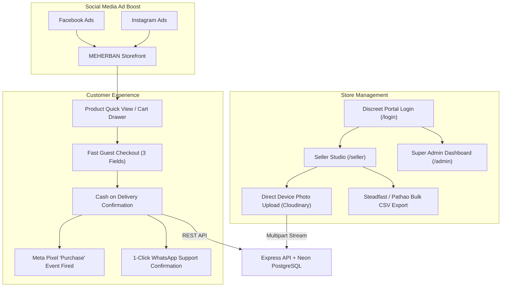

# 💎 MEHERBAN — Luxury Fashion E-Commerce Storefront

[](https://nextjs.org/)
[](https://react.dev/)
[](https://www.typescriptlang.org/)
[](https://tailwindcss.com/)

**MEHERBAN** ("WEAR YOUR STORY") is an exclusive high-conversion luxury fashion e-commerce platform optimized specifically for **Facebook & Instagram ad boost traffic** in Bangladesh. Built with **Next.js 16 (App Router + Turbopack)** and **Tailwind CSS**.

---

## 🌟 Core Features

1. **🚀 100% Frictionless Guest Checkout (Zero Login Required)**:
   - Designed for cold ad traffic from Instagram and Facebook.
   - Customers never see forced login/registration walls; orders complete in seconds with just Name, Mobile, and Address.
   - Real-time Bangladeshi phone validation (`/^01[3-9]\d{8}$/`).

2. **💵 Strictly Cash on Delivery (COD Only)**:
   - Eliminates drop-offs from failed payment gateways.
   - "পণ্য হাতে পেয়ে দেখে মূল্য পরিশোধ করবেন — কোনো অগ্রিম পেমেন্টের ঝুঁকি নেই।"
   - Automatic free delivery calculation for orders over ৳1,999.

3. **🛍️ Clean & Focused Storefront Navigation**:
   - Zero internal seller or admin badges visible to casual shoppers.
   - Clean luxury navigation: Hero, Collections, Trending, Lookbook, Instagram Showcase.
   - Subtle account portal entrypoint linking to `/login`.

4. **⚡ Single-Seller & Management Hub (`/seller` & `/admin`)**:
   - **Direct Storage Photo Uploads**: Drag-and-drop or select files directly from laptop or mobile storage with automatic Cloudinary CDN optimization.
   - **Real-Time Stock Controls**: 1-click In Stock / Unavailable toggles and stock quantity incrementors.
   - **Frontpage Visual Studio**: Modify hero slides, category cards, promo banners, and Instagram feed live.
   - **1-Click Courier Bulk Export**: Download Steadfast & Pathao ready booking CSVs directly from the orders management panel.

5. **🎯 Meta Pixel Attribution**:
   - Client-side Meta Pixel loader firing real-time `Purchase` conversion events with BDT currency and order values for ROAS optimization.

---

## 🏛️ Architecture Flow



---

## 🚀 Local Setup & Installation

### Prerequisites
- Node.js v18+
- MEHERBAN Backend running on `http://localhost:5000`

### Step 1: Install Dependencies
```bash
npm install
```

### Step 2: Configure Environment
Copy `.env.example` to `.env.local`:
```env
NEXT_PUBLIC_API_URL=http://localhost:5000/api/v1
NEXT_PUBLIC_FACEBOOK_PIXEL_ID="" # Optional: Your Meta Pixel ID
```

### Step 3: Run Development Server
```bash
npm run dev
```
Open [http://localhost:4000](http://localhost:4000) in your browser.

---

## 🔑 Demo Management Credentials
| Role | Login URL | Email / Username | Password |
|---|---|---|---|
| **Seller** | `/login` or `/seller` | `seller@meherban.com` | `seller123` |
| **Super Admin** | `/login` or `/admin` | `admin@meherban.com` | `admin123` |
